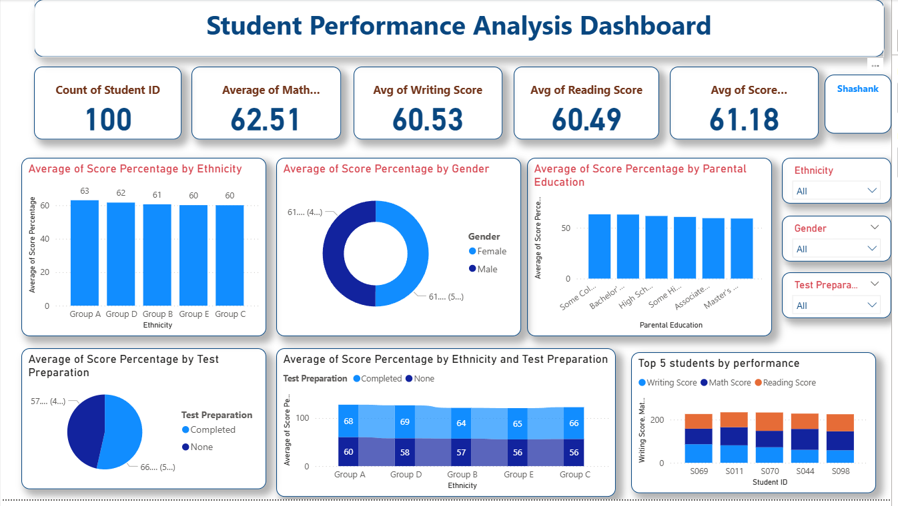

# Student Performance Analysis Dashboard

A school mini-project that explores student marks in mathematics, reading, and writing. The dashboard summarizes overall performance and compares average scores across ethnicity groups, gender, parental education, and test-preparation status.

> **Project status:** Documentation, the Excel source workbook, and a dashboard screenshot are included. The original editable Power BI `.pbix` file was not part of the supplied files, so the interactive report itself is not included in this repository yet.

## Dashboard preview



## Project at a glance

| Item | Details |
|---|---|
| Project type | School mini-project / exploratory data analysis |
| Dataset size | 100 student records |
| Source data | Excel workbook in [`data/`](data/) |
| Dashboard tool | Microsoft Power BI (inferred from the supplied dashboard screenshot) |
| Subjects | Math, reading, and writing |
| Main goal | Compare score patterns across the available student groups and test-preparation categories |

## Project objectives

- Summarize student scores with easy-to-read KPI cards.
- Compare average performance by ethnicity group, gender, and parental education.
- Explore score differences between students who completed test preparation and those who did not.
- Compare math, reading, and writing scores for students highlighted in the dashboard.
- Present the findings in a single dashboard that can be filtered by category.

## Key metrics

These values were calculated from the supplied workbook, which contains 100 student records.

| Metric | Result |
|---|---:|
| Number of students | 100 |
| Average math score | 62.51 / 100 |
| Average reading score | 60.49 / 100 |
| Average writing score | 60.53 / 100 |
| Overall average across the three subjects | 61.18 / 100 |

The overall average is the arithmetic mean of the three subject averages. Since each subject score is on a 0–100 scale, the numeric average also represents the percentage of the maximum possible score.

## What the dashboard contains

1. **KPI cards** — total student count, subject averages, and the overall average score.
2. **Ethnicity comparison** — average score across the five ethnicity groups in the dataset.
3. **Gender comparison** — overall average score split between female and male students.
4. **Parental education comparison** — average scores for the recorded parental-education categories.
5. **Test-preparation comparison** — average score for students marked `Completed` versus `None`.
6. **Ethnicity × test-preparation chart** — compares the two preparation categories within each ethnicity group.
7. **Top-students chart** — compares math, reading, and writing scores for the students highlighted by the report.
8. **Slicers / filters** — ethnicity, gender, and test-preparation status can be selected to explore subsets of the data.

## Findings from the workbook

- **Math has the highest subject average** at 62.51. Reading averages 60.49 and writing averages 60.53, so the overall subject averages are fairly close.
- **The test-preparation groups differ in this sample.** Students marked `Completed` average 66.34 across the three subjects; students marked `None` average 57.59, a difference of 8.75 points.
- **Average scores by gender are similar.** The calculated overall average is 61.26 for female students and 61.08 for male students.
- **Ethnicity-group averages are within a relatively narrow range.** Group A has the highest calculated average (63.03), while Group C has the lowest (60.04) in this dataset.
- **Parental-education categories also vary.** The `Some College` group averages 63.31, while the `Master's Degree` group averages 59.18 across the three subjects in this sample.

These are descriptive results, not evidence that gender, ethnicity, parental education, or test preparation causes a particular score. Group sizes are not identical, and the workbook contains only 100 records; results should not be generalized beyond this sample without more data and context. See [`docs/findings.md`](docs/findings.md) for more detail.

## Dataset and fields

The workbook is [`data/student_performance_100.xlsx`](data/student_performance_100.xlsx). Its worksheet is named `Sheet1` and contains one header row plus 100 student records.

| Column | Description |
|---|---|
| `Student ID` | An identifier such as `S001`; no student names are included in the supplied file. |
| `Gender` | Gender category recorded in the dataset. |
| `Ethnicity` | Group category, such as Group A or Group B. |
| `Parental Education` | Recorded parental-education category. |
| `Test Preparation` | `Completed` or `None`. |
| `Math Score` | Math mark on a 0–100 scale. |
| `Reading Score` | Reading mark on a 0–100 scale. |
| `Writing Score` | Writing mark on a 0–100 scale. |

More field definitions are available in [`docs/data-dictionary.md`](docs/data-dictionary.md).

## How to explore or rebuild the dashboard

1. Download or clone this repository.
2. Open `data/student_performance_100.xlsx` in Excel to inspect the source records.
3. In Power BI Desktop, choose **Get data → Excel workbook**, select the file, and load `Sheet1`.
4. Check that the three score fields are numeric and the category fields are treated as text.
5. Create the KPI measures below, then build the charts described in [What the dashboard contains](#what-the-dashboard-contains).
6. Save the Power BI report as `dashboard/student-performance-analysis.pbix` and add it to the repository if you have the editable report file.

### Example DAX measures

Use the table name Power BI assigns to the imported worksheet if it is not `Sheet1`.

```dax
Student Count =
DISTINCTCOUNT('Sheet1'[Student ID])

Average Math Score =
AVERAGE('Sheet1'[Math Score])

Average Reading Score =
AVERAGE('Sheet1'[Reading Score])

Average Writing Score =
AVERAGE('Sheet1'[Writing Score])

Overall Average Score =
DIVIDE(
    [Average Math Score] + [Average Reading Score] + [Average Writing Score],
    3
)
```

Format `Overall Average Score` as a decimal number with two decimal places, not as a percentage-formatted fraction. The source marks are already on a 0–100 scale.

## Repository structure

```text
student-performance-analysis/
├── README.md
├── data/
│   └── student_performance_100.xlsx
├── dashboard/
│   └── README.md
├── docs/
│   ├── data-dictionary.md
│   └── findings.md
└── images/
    └── dashboard-preview.png
```

## Tools and skills demonstrated

- Excel data handling
- Power BI dashboard layout and KPI design
- DAX measures (examples provided above)
- Group-wise comparison and descriptive analysis
- Data storytelling and documenting analysis for a portfolio

## Data-sharing note

Before making this repository public, confirm that your school, instructor, and the dataset's terms allow the workbook to be shared. Student marks can be sensitive even when records use IDs instead of names. If you do not have permission to publish the row-level data, make the repository private or replace the workbook with approved anonymized or aggregated data.

